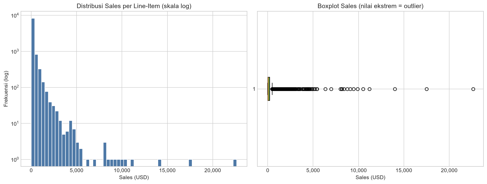
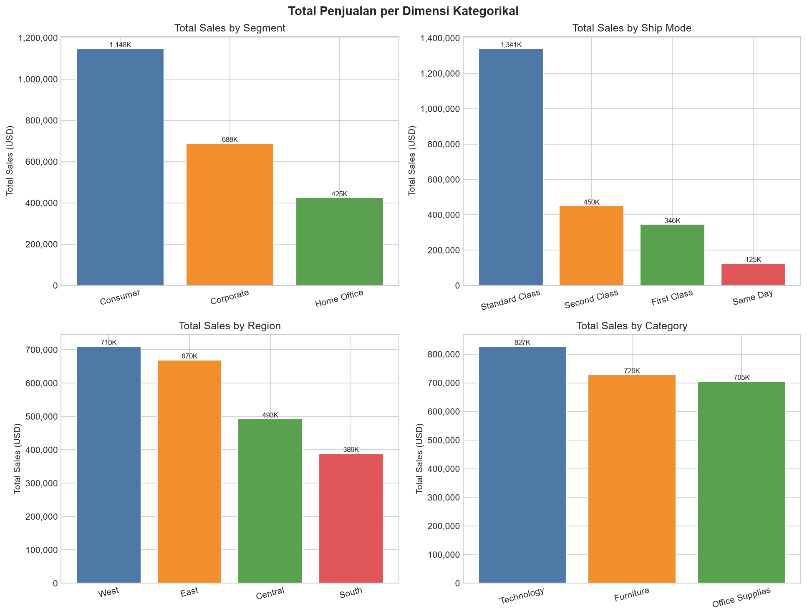
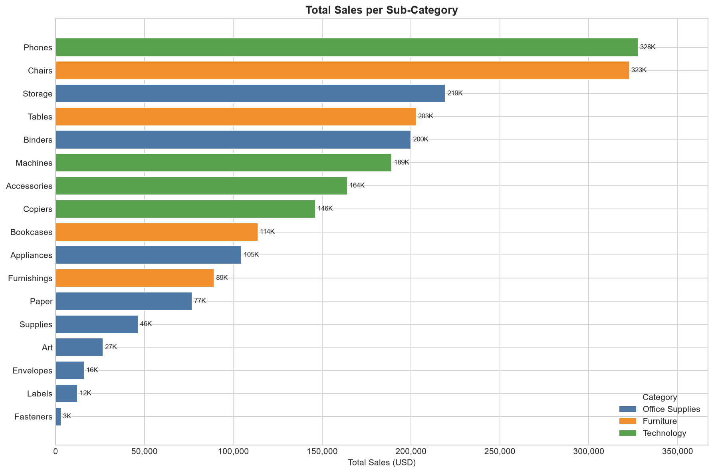
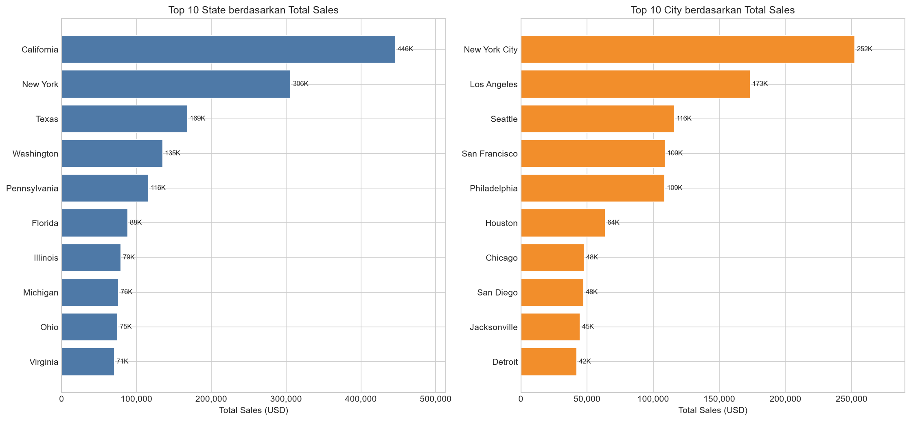
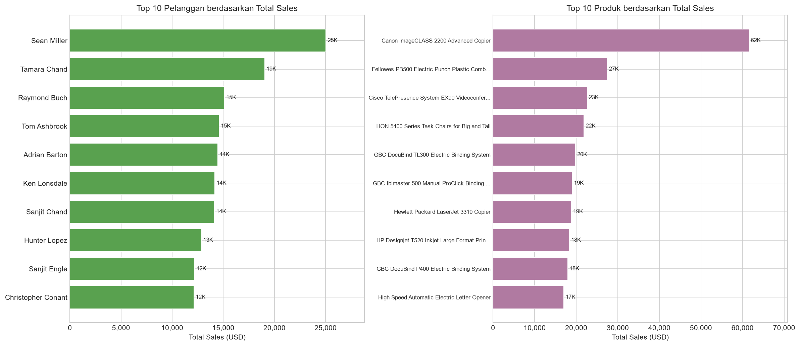
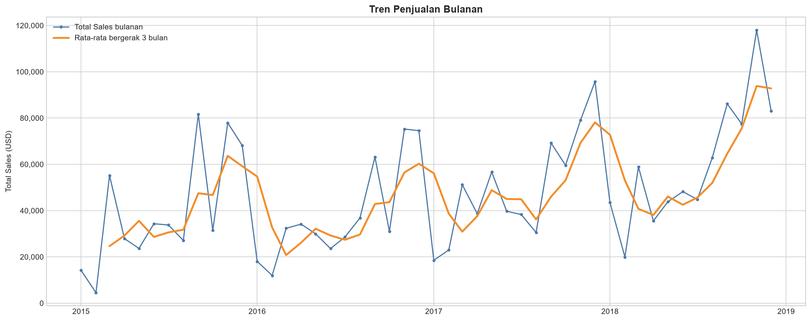
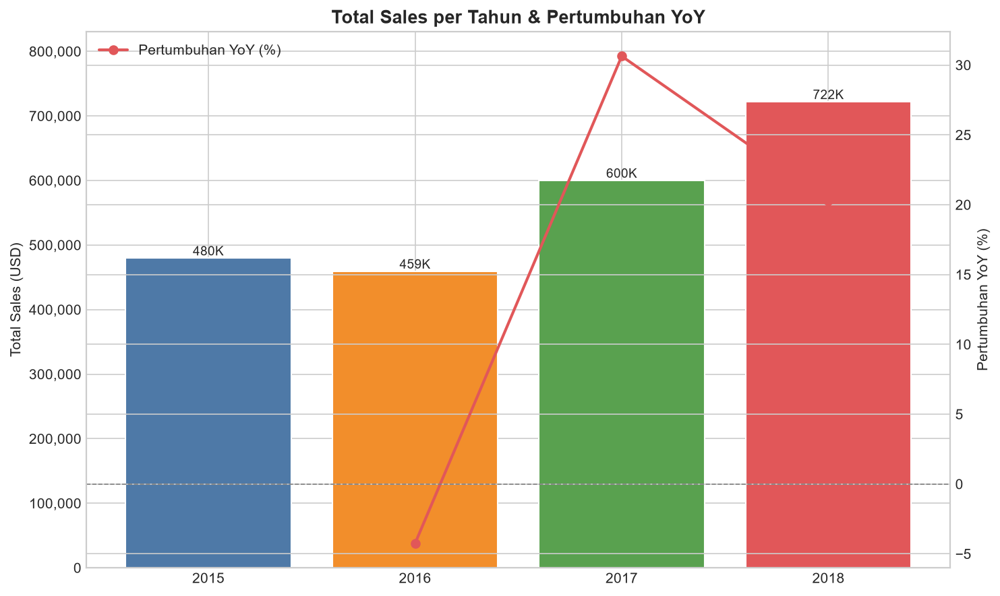
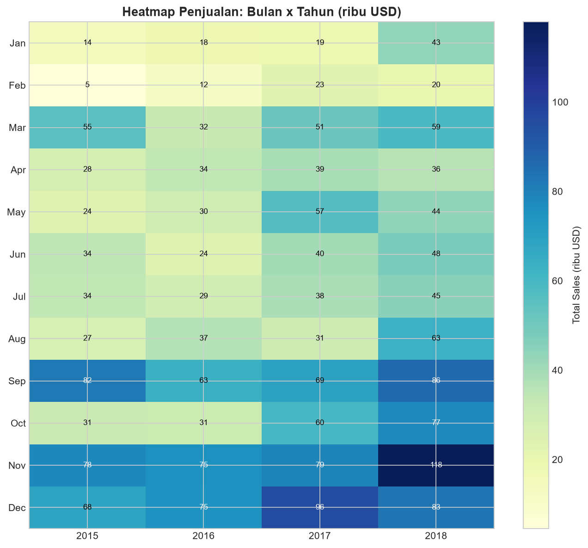
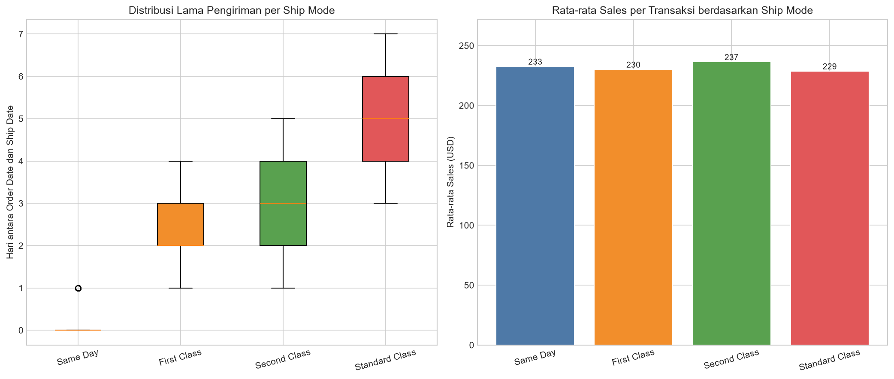

# Superstore Sales: Exploratory Data Analysis

Proyek ini melakukan analisis data eksploratif (EDA) menyeluruh pada dataset **Superstore Sales**:
9.800 baris transaksi dari Januari 2015 hingga Desember 2018 dengan total penjualan **USD 2,26 juta**.
Seluruh analisis dijalankan di dalam **Jupyter Notebook** dan mencakup pemeriksaan kualitas data, pembuatan fitur (*feature engineering*), statistik deskriptif, 9 visualisasi, serta pembahasan insight bisnis.

> **Dataset:** [Superstore Sales Forecasting (Kaggle)](https://www.kaggle.com/datasets/rohitsahoo/sales-forecasting)

---

## Tujuan Analisis

1. Menilai kualitas data mentah: *missing value*, duplikat, dan anomali tanggal.
2. Memahami pola penjualan berdasarkan distribusi nilai transaksi, kategori, wilayah,
   pelanggan, dan produk.
3. Menganalisis tren waktu (bulanan, tahunan, dan musiman) serta pertumbuhan YoY.
4. Menilai kualitas layanan pengiriman pada setiap mode pengiriman.
5. Menyusun rekomendasi yang didasarkan pada temuan analisis.

---

## Struktur Project

```
.
├── ipynb/
│   └── Analysis.ipynb     # seluruh proses EDA (kode + grafik inline)
├── eda_output/            # hasil analisis (dibuat otomatis oleh notebook)
│   ├── eda_summary.txt    # ringkasan teks
│   ├── 01–09_*.png        # 9 visualisasi
│   └── agg_*.csv          # 6 tabel agregat
└── README.md
```

| File hasil | Isi |
|---|---|
| `eda_output/eda_summary.txt` | Ringkasan lengkap seluruh tahap analisis |
| `eda_output/01–09_*.png` | Grafik visualisasi yang ditampilkan di README ini |
| `eda_output/agg_yearly_sales.csv` | Total penjualan per tahun |
| `eda_output/agg_monthly_sales.csv` | Total penjualan per bulan |
| `eda_output/agg_sales_by_category.csv` | Penjualan per kategori dan sub-kategori |
| `eda_output/agg_sales_by_region.csv` | Penjualan per region dan state |
| `eda_output/agg_top_customers.csv` | Pelanggan dengan penjualan terbesar |
| `eda_output/agg_top_products.csv` | Produk dengan penjualan terbesar |

---

## Stack

`Python` · `Pandas` · `NumPy` · `Matplotlib` · `Seaborn` · `kagglehub` · `Jupyter Notebook`

---

## Cara Menjalankan

```bash
# 1. Clone repository
git clone https://github.com/Az-Rof/data-analyst-superstore-sales-eda.git
cd data-analyst-superstore-sales-eda

# 2. (Opsional) Buat virtual environment
python -m venv .venv
.venv\Scripts\activate          # Windows
# source .venv/bin/activate     # macOS / Linux

# 3. Install dependensi
pip install pandas numpy matplotlib seaborn kagglehub jupyter

# 4. Jalankan notebook
jupyter notebook ipynb/Analysis.ipynb
```

Buka `ipynb/Analysis.ipynb` lalu jalankan **Run All**. Dataset `train.csv` diunduh otomatis
dari Kaggle pada run pertama; untuk melewati proses unduhan, letakkan `train.csv` di root project.
Seluruh grafik dan tabel agregat akan ditulis ulang ke folder `eda_output/`.

---

## Alur Analisis

| Tahap | Isi |
|---|---|
| **1. Setup** | Import library, konfigurasi palet warna, dan helper penyimpanan grafik |
| **2. Persiapan Data** | Mengunduh atau memuat dataset, parsing tanggal (`dd/mm/yyyy`), serta membuat fitur turunan (tahun, bulan, kuartal, lama pengiriman) |
| **3. Overview Dataset** | Jumlah baris dan kolom, rentang tanggal, entitas unik, serta struktur kolom |
| **4. Kualitas Data** | *Missing value*, duplikat, tanggal kirim tidak valid, dan statistik `Sales` |
| **5. Statistik Deskriptif** | Ringkasan kolom numerik dan frekuensi kolom kategorikal |
| **6. Visualisasi** | Distribusi, dimensi kategori, sub-kategori, geografi, pelanggan dan produk, tren, heatmap, serta pengiriman |
| **7. Tabel Agregat** | Mengekspor 6 tabel analisis ke CSV |
| **8. Kesimpulan** | Rangkuman insight dan rekomendasi |

---

## Overview Dataset

| Metrik | Nilai |
|---|---|
| Jumlah baris (line-item) | **9.800** |
| Jumlah kolom | **23** |
| Rentang tanggal order | 03 Jan 2015 – 30 Des 2018 |
| Order ID unik | 4.922 |
| Pelanggan unik | 793 |
| Produk unik | 1.861 |
| Total penjualan | **USD 2.261.536,78** |

**Fitur turunan yang dibuat:** `Order Year`, `Order Month`, `Month Name`,
`Order Quarter`, dan `Shipping Days` (selisih tanggal kirim dan tanggal order).

---

## Kualitas Data

| Pemeriksaan | Hasil |
|---|---|
| *Missing value* | Hanya `Postal Code`, sebanyak **11 baris (0,11%)** |
| Baris duplikat penuh | 0 |
| Duplikat tanpa `Row ID` | **1** |
| `Ship Date` lebih awal dari `Order Date` | 0 |
| Sales minimum dan maksimum | USD 0,44 dan USD 22.638,48 |
| Sales mean dan median | USD 230,77 dan **USD 54,49** |
| Standar deviasi Sales | USD 626,65 |

Selisih antara mean (USD 230,77) dan median (USD 54,49) menjadi sinyal awal bahwa distribusi penjualan sangat *right-skewed*: mayoritas transaksi bernilai kecil, sementara segelintir transaksi bernilai sangat besar. Temuan ini terkonfirmasi pada grafik 01.

---

## Hasil Analisis dan Visualisasi

### 1) Distribusi Nilai Transaksi

Distribusi `Sales` per baris transaksi (skala log) beserta boxplot untuk melihat *outlier*.



**Temuan:** Distribusi sangat miring ke kanan. Sebagian besar transaksi bernilai di bawah
USD 100, sementara sejumlah kecil transaksi bernilai di atas USD 10.000 dan menjadi *outlier*.
Rata-rata (mean) menjadi menyesatkan untuk mengukur transaksi tipikal, sehingga median jauh
lebih representatif.

---

### 2) Penjualan per Dimensi Kategorikal

Perbandingan total penjualan berdasarkan **Segment**, **Ship Mode**, **Region**, dan **Category**.



| Dimensi | Urutan (besar ke kecil) |
|---|---|
| **Segment** | Consumer (1,15 jt) · Corporate (689 rb) · Home Office (425 rb) |
| **Ship Mode** | Standard Class (1,34 jt) · Second Class (450 rb) · First Class (346 rb) · Same Day (125 rb) |
| **Region** | West (710 rb) · East (670 rb) · Central (493 rb) · South (389 rb) |
| **Category** | Technology (827 rb) · Furniture (729 rb) · **Office Supplies** (705 rb) |

**Temuan:** Segmen **Consumer** mendominasi dengan sekitar 51% penjualan. **Technology**
unggul dalam nilai penjualan meskipun jumlah transaksinya paling sedikit, yang berarti nilai
per transaksi pada kategori ini tinggi. Menariknya, **Office Supplies** justru memiliki jumlah
transaksi terbanyak (5.909) tetapi nilai penjualan terendah.

---

### 3) Penjualan per Sub-Kategori

Ketujuh belas sub-kategori diurutkan berdasarkan total penjualan dan diwarnai menurut kategori induknya.



| Peringkat | Sub-Kategori | Kategori | Sales (USD) |
|---|---|---|---|
| 1 | **Phones** | Technology | 328 rb |
| 2 | Chairs | Furniture | 323 rb |
| 3 | Storage | Office Supplies | 219 rb |
| 4 | Tables | Furniture | 203 rb |
| 5 | Binders | Office Supplies | 200 rb |
| … | … | … | … |
| 17 | Fasteners | Office Supplies | 3 rb |

**Temuan:** **Phones** dan **Chairs** hampir setara dan menyumbang porsi terbesar dari total
penjualan. Sub-kategori bernilai kecil (Fasteners, Labels, Envelopes) banyak terjual, tetapi
kontribusinya minim, sehingga lebih cocok diposisikan sebagai produk pelengkap daripada
penggerak pendapatan.

---

### 4) Top 10 State dan City

Wilayah dengan penjualan terbesar.



| Peringkat | State | Sales | City | Sales |
|---|---|---|---|---|
| 1 | **California** | 446 rb | **New York City** | 252 rb |
| 2 | New York | 306 rb | Los Angeles | 173 rb |
| 3 | Texas | 169 rb | Seattle | 116 rb |
| 4 | Washington | 135 rb | San Francisco | 109 rb |
| 5 | Pennsylvania | 116 rb | Philadelphia | 109 rb |

**Temuan:** Terdapat konsentrasi geografis yang kuat. California dan New York menyumbang
lebih dari sepertiga total penjualan, dan kota dengan penjualan tertinggi didominasi oleh
area metropolitan padat.

---

### 5) Top Pelanggan dan Produk

Kontributor terbesar dari sisi pelanggan maupun produk.



| # | Pelanggan | Sales (USD) | Transaksi |
|---|---|---|---|
| 1 | Sean Miller | 25.043,05 | 15 |
| 2 | Tamara Chand | 19.052,22 | 12 |
| 3 | Raymond Buch | 15.117,34 | 18 |
| 4 | Tom Ashbrook | 14.595,62 | 10 |
| 5 | Adrian Barton | 14.473,57 | 20 |

| # | Produk | Sales (USD) | Terjual |
|---|---|---|---|
| 1 | Canon imageCLASS 2200 Advanced Copier | 61.599,82 | 5× |
| 2 | Fellowes PB500 Electric Punch Binding Machine | 27.453,38 | 10× |
| 3 | Cisco TelePresence System EX90 | 22.638,48 | 1× |
| 4 | HON 5400 Series Task Chairs (Big and Tall) | 21.870,58 | 8× |
| 5 | GBC DocuBind TL300 Electric Binding System | 19.823,48 | 11× |

**Temuan:** Sepuluh pelanggan teratas hanya menyumbang **6,8%** dari total penjualan, sehingga
basis pelanggan sangat tersebar dan tidak bergantung pada segelintir pembeli. Sebaliknya,
penjualan dari sisi produk sangat terkonsentrasi: satu produk saja (Canon Copier) menyumbang
USD 61.600 hanya dari 5 transaksi.

---

### 6) Tren Penjualan Bulanan

Penjualan bulanan sepanjang 2015–2018 dengan garis rata-rata bergerak 3 bulan.



**Temuan:** Pola musiman terlihat jelas dengan puncak pada akhir setiap tahun. Penjualan
menunjukkan tren naik yang konsisten dari 2016 hingga 2018, diiringi fluktuasi bulanan yang
besar, terutama lonjakan tajam menjelang kuartal keempat (Q4).

---

### 7) Penjualan Tahunan dan Pertumbuhan YoY

Total penjualan per tahun beserta laju pertumbuhan tahunan (*Year-over-Year*).



| Tahun | Total Sales (USD) | YoY |
|---|---|---|
| 2015 | 479.856,21 | — |
| 2016 | 459.436,01 | **−4,3%** |
| 2017 | 600.192,55 | **+30,6%** |
| 2018 | 722.052,02 | **+20,3%** |

**Temuan:** Setelah penurunan pada 2016, bisnis tumbuh dua digit secara konsisten
(2017: +30,6%, 2018: +20,3%) dan mencapai titik tertinggi pada 2018.

---

### 8) Heatmap Musiman: Bulan x Tahun

Heatmap intensitas penjualan untuk mendeteksi pola musiman antar tahun (dalam ribuan USD).



**Temuan:**
- **November** konsisten menjadi bulan terkuat setiap tahun; **Nov 2018** adalah bulan terbaik
  secara keseluruhan dengan penjualan **USD 117.938,15**.
- **Desember** juga tinggi, yang mengindikasikan musim belanja akhir tahun.
- **Februari** adalah bulan terlemah; nilai terendah terjadi pada Feb 2015 sebesar USD 4.519,89.
- Kuartal terbaik adalah **Q4 2018** dengan penjualan **USD 278.416,67**.

---

### 9) Analisis Pengiriman

Distribusi lama pengiriman dan rata-rata nilai transaksi pada setiap mode pengiriman.



| Ship Mode | Transaksi | Total Sales (USD) | Rata-rata Sales | Rata-rata Hari Kirim |
|---|---|---|---|---|
| Same Day | 538 | 125.219,04 | 232,75 | 0,04 |
| First Class | 1.501 | 345.572,26 | 230,23 | 2,18 |
| Second Class | 1.902 | 449.914,18 | 236,55 | 3,25 |
| Standard Class | 5.859 | 1.340.831,31 | 228,85 | 5,01 |

**Temuan:** **Standard Class** mendominasi dengan sekitar 60% transaksi dan menyumbang sekitar
59% penjualan. Nilai rata-rata transaksi relatif seragam pada semua mode pengiriman
(USD 229–237), artinya pilihan mode pengiriman tidak bergantung pada nilai transaksi.

---

## Insight Utama

| # | Insight | Nilai |
|---|---|---|
| 1 | Total penjualan (2015–2018) | **USD 2.261.536,78** |
| 2 | Pertumbuhan 2017 ke 2018 | **+20,3%** |
| 3 | Musim terkuat | **November** (puncak: Nov 2018, USD 117.938) |
| 4 | Kategori dan sub-kategori dengan penjualan terbesar | **Technology** dan **Phones** |
| 5 | Region, state, dan kota dengan penjualan terbesar | **West**, **California**, dan **New York City** |
| 6 | Segmen dominan | **Consumer** (sekitar 51% penjualan) |
| 7 | Konsentrasi pelanggan | 10 pelanggan teratas = **6,8%** dari total penjualan (tersebar) |
| 8 | Konsentrasi produk | Produk teratas = **USD 61.600** dari 5 transaksi |
| 9 | Distribusi transaksi | Sangat *right-skewed* (median USD 54 vs mean USD 231) |
| 10 | Mode pengiriman dominan | **Standard Class** (sekitar 60% transaksi dan 59% penjualan) |

---

## Rekomendasi

1. **Manfaatkan momentum Q4.** Alokasikan stok, anggaran promosi, dan tenaga kerja pengiriman
   lebih besar pada September–Desember untuk memaksimalkan puncak musiman.
2. **Fokus pada Technology dan Phones.** Kedua kategori ini memiliki nilai transaksi tinggi;
   dorong strategi *bundling* atau *up-selling* dari kategori bernilai rendah.
3. **Kelola konsentrasi geografis.** Pertahankan pasar California dan New York, sekaligus
   kembangkan wilayah **South** (penjualan terendah) sebagai peluang pertumbuhan.
4. **Evaluasi layanan pengiriman premium.** Same Day dan First Class memiliki nilai transaksi
   yang serupa dengan mode lain, tetapi porsinya kecil; terdapat potensi peningkatan margin
   layanan pada kedua mode ini.
5. **Manfaatkan basis pelanggan yang tersebar.** Program loyalitas yang tepat sasaran bagi
   pelanggan bernilai tinggi (misalnya Sean Miller dan Tamara Chand) dapat meningkatkan
   pembelian berulang.

---

## Catatan Analisis

- `Row ID` dikecualikan dari statistik karena hanya berfungsi sebagai identifier.
- `Postal Code` dibaca sebagai angka (*float*) karena beberapa kode pos mengandung nilai yang
  tidak valid; hal ini wajar untuk analisis pada tingkat wilayah.
- Karena distribusi `Sales` sangat miring, **median** lebih tepat dipakai daripada mean untuk
  merepresentasikan transaksi tipikal.
- Dataset ini hanya memiliki kolom **Sales** (nilai penjualan) dan tidak memiliki kolom
  **Profit**, sehingga analisis profitabilitas berada di luar cakupan proyek ini.
